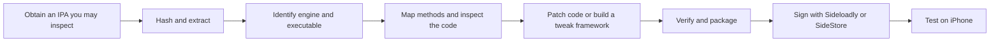

# iOS app reverse-engineering notes

A repeatable workflow for understanding an iOS app, making a targeted local
modification, and signing it for an iPhone. It covers IPA inspection, optional Hopper use,
Unity IL2CPP method mapping, direct binary patches, framework injection, and
sideloading with Sideloadly or SideStore.

The motivating example was Bryce Bostwick's
[CatTok video](https://www.youtube.com/watch?v=YW3jL2gI9IE). His result is one
modified app installed on the phone: a framework is injected into the existing IPA
before signing. A Unity IL2CPP app can use a direct machine-code patch instead.

## Quick start

### What you need

- A Mac with Xcode command-line tools (`xcode-select --install`).
- An iPhone and a data-capable USB cable.
- A free Apple Account for signing. A spare account is best.
- An ARMConverter account, to download decrypted IPAs.

### Step 1: Get the decrypted IPA

1. Open [ARMConverter's US store](https://armconverter.com/store/us).
2. Create an account and log in.
3. Find the app and download its **IPA**.

Details: [Get a decrypted IPA](docs/01-obtain-and-inspect.md#get-a-decrypted-ipa).

### Step 2: Unpack it and find the code

1. Hash and unzip the IPA into `artifacts/`.
2. Read `Info.plist` to find the main executable. Check that the binary is not encrypted.

Details: [Obtain and inspect an IPA](docs/01-obtain-and-inspect.md). An AI agent
can do steps 2 to 4 for you: point it at this repository and the IPA.

### Step 3: Find what to change

1. For a Unity game, map method names to native addresses with the IL2CPP metadata.
2. Read the disassembly of the methods that own the behavior. Hopper is optional.

Details: [Map code and inspect it](docs/02-hopper-and-il2cpp.md).

### Step 4: Make the change

Choose one:

- **Patch the binary.** Change a few instructions and write a new IPA.
- **Inject a framework.** Build a framework in Xcode and add it with Sideloadly.

Details: [Choose a patch strategy](docs/03-patch-and-package.md).

### Step 5: Prepare the iPhone (one time)

1. Connect the iPhone to the Mac, unlock it, and tap **Trust This Computer**.
2. On iOS 16 or newer, open **Settings → Privacy & Security → Developer Mode**,
   turn it on, and let the phone restart.
3. If **Developer Mode** is missing, open Xcode with the iPhone connected so Xcode
   pairs with it. Then check the setting again.

Details: [Set up the phone](docs/04-sideload-iphone.md#set-up-the-phone).

### Step 6: Sign and install

Choose one:

- **Sideloadly** (simplest). Sign and install from the Mac.
  [Sign and install](docs/04-sideload-iphone.md#sign-and-install).
- **SideStore.** Sign on the phone, so you do not need the Mac every week.
  [One-time setup](docs/sidestore.md#one-time-setup), then
  [install one modified IPA](docs/sidestore.md#install-one-modified-ipa).

After the first install, open **Settings → General → VPN & Device Management**,
select your Apple Account, and tap **Trust**.

### Step 7: Refresh every 7 days

A free Apple Account signature lasts 7 days. After that, the app does not open.

- **Sideloadly:** re-sign from the Mac before 7 days pass.
- **SideStore:** tap the days counter in **My Apps**, or
  [automate it with Shortcuts](docs/sidestore.md#refresh-from-shortcuts-every-few-days).

A free account also allows only 3 sideloaded apps at once (SideStore counts as one) and 10 new App IDs per
7 days. See [Free Apple Account limits](docs/sidestore.md#free-apple-account-limits).

### If something fails

Read [Troubleshooting](docs/05-troubleshooting.md) and the
[SideStore error table](docs/sidestore.md#troubleshooting).

## Full reading list

1. [Agent handbook](knowledge/AGENT_HANDBOOK.md): how to choose a strategy, trace
   state and callers, install hooks, preserve completion, and validate changes.
2. [Obtain and inspect the IPA](docs/01-obtain-and-inspect.md). Decrypted IPAs come from
   [ARMConverter's US store](https://armconverter.com/store/us) (account and login required).
3. [Map code and inspect it](docs/02-hopper-and-il2cpp.md). Hopper is optional.
4. [Choose binary patching or framework injection](docs/03-patch-and-package.md)
5. [Sign, sideload, trust, and test on iPhone](docs/04-sideload-iphone.md)
6. [Sideload any later IPA with SideStore](docs/sidestore.md)
7. [Troubleshooting and lessons learned](docs/05-troubleshooting.md)
8. [Bryce Bostwick's videos and tips](references/bryce/README.md)

[VIDEO_LESSONS.md](knowledge/VIDEO_LESSONS.md) captures the conclusions from ten
of Bryce's videos. The six notes under `knowledge/techniques/` explain mechanisms,
procedures, pitfalls, and expected evidence.

## Start a new investigation

Copy the [investigation template](templates/investigation.md) for each app and
version, and the [sideload record](templates/sideload-app.md) for each install.
Method addresses and bytes are specific to one binary. Reuse the workflow, not
the offsets.

Tools: macOS, Xcode command-line tools, Python, Unicorn, and Sideloadly or
SideStore. Hopper is optional; agents usually do not need it.

## Consider Android first

If the app also exists for Android, an APK on an Android phone can be easier to
work with. Java and Kotlin code in an APK decompiles to readable source with tools
such as [jadx](https://github.com/skylot/jadx), and installing a modified APK does
not need Apple signing or a seven-day refresh. A Unity IL2CPP game is still native
code on Android (`libil2cpp.so`), so the mapping steps in this repository still
apply to it.

## Scope

Use these notes only on apps you are entitled to inspect and modify. Keep IPAs,
extracted assets, Hopper databases, and signing material out of Git. The
`.gitignore` already excludes them.

**Automated checks do not establish device behavior.** Keep static analysis,
emulation, and device results separate in your records.
