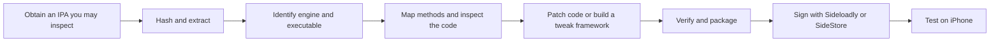

# iOS app reverse-engineering notes

A repeatable workflow for understanding an iOS app, making a targeted local
modification, and signing it for an iPhone. It covers IPA inspection, optional Hopper use,
Unity IL2CPP method mapping, direct binary patches, framework injection, and
sideloading with Sideloadly or SideStore.

The motivating example was Bryce Bostwick's
[CatTok video](https://www.youtube.com/watch?v=YW3jL2gI9IE). His result is one
modified app installed on the phone: a framework is injected into the existing IPA
before signing. A Unity IL2CPP app can use a direct machine-code patch instead.

## Read in this order

1. [Agent handbook](knowledge/AGENT_HANDBOOK.md): how to choose a strategy, trace
   state and callers, install hooks, preserve completion, and validate changes.
2. [Obtain and inspect the IPA](docs/01-obtain-and-inspect.md). Decrypted IPAs come from
   [ARMConverter's US store](https://armconverter.com/store/us) (account and login required).
3. [Map code and inspect it](docs/02-hopper-and-il2cpp.md). Hopper is optional.
4. [Choose binary patching or framework injection](docs/03-patch-and-package.md)
5. [Sign, sideload, trust, and test on iPhone](docs/04-sideload-iphone.md)
6. [Sideload any later IPA with SideStore](docs/sidestore.md)
7. [Troubleshooting and lessons learned](docs/05-troubleshooting.md)
8. [Bryce Bostwick's videos and tips](references/bryce/README.md)

[VIDEO_LESSONS.md](knowledge/VIDEO_LESSONS.md) captures the conclusions from ten
of Bryce's videos. The six notes under `knowledge/techniques/` explain mechanisms,
procedures, pitfalls, and expected evidence.

## Start a new investigation

Copy the [investigation template](templates/investigation.md) for each app and
version, and the [sideload record](templates/sideload-app.md) for each install.
Method addresses and bytes are specific to one binary. Reuse the workflow, not
the offsets.

Tools: macOS, Xcode command-line tools, Python, Unicorn, and Sideloadly or
SideStore. Hopper is optional; agents usually do not need it.

## Consider Android first

If the app also exists for Android, an APK on an Android phone can be easier to
work with. Java and Kotlin code in an APK decompiles to readable source with tools
such as [jadx](https://github.com/skylot/jadx), and installing a modified APK does
not need Apple signing or a seven-day refresh. A Unity IL2CPP game is still native
code on Android (`libil2cpp.so`), so the mapping steps in this repository still
apply to it.

## Scope

Use these notes only on apps you are entitled to inspect and modify. Keep IPAs,
extracted assets, Hopper databases, and signing material out of Git. The
`.gitignore` already excludes them.

**Automated checks do not establish device behavior.** Keep static analysis,
emulation, and device results separate in your records.
